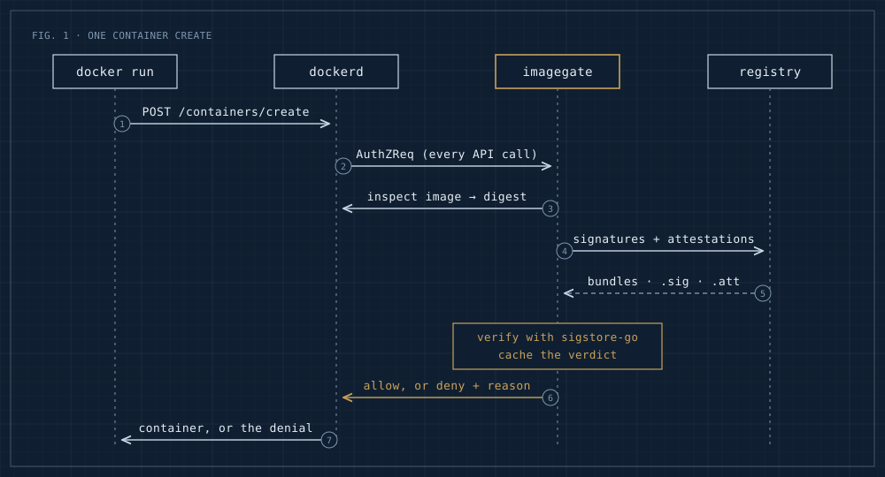
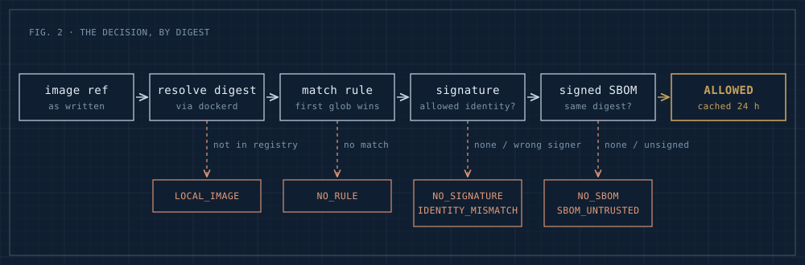

<p align="center">
  
</p>

<p align="center">
  <a href="https://github.com/rossedman/imagegate/actions/workflows/ci.yml"></a>
  <a href="https://rossedman.github.io/imagegate/"></a>
  <a href="LICENSE"></a>
  <a href="https://github.com/rossedman/imagegate/releases"></a>
  <a href="https://pkg.go.dev/github.com/rossedman/imagegate"></a>
</p>

**imagegate** is a Docker authorization plugin. It denies container creation
unless the image digest carries a [cosign](https://github.com/sigstore/cosign)
signature from an identity you trust **and** a signed SPDX or CycloneDX SBOM
attestation. It runs on the host, next to dockerd, so Dockerfiles, Compose
files and `docker run` commands stay exactly as they are.

```console
$ docker run ghcr.io/acme/api:1.4.2
docker: Error response from daemon: authorization denied by plugin imagegate: imagegate: denied ghcr.io/acme/api@sha256:3f9c…
reason: NO_SBOM — no SPDX or CycloneDX attestation signed by identity "ci-main"
fix: https://wiki.acme.internal/imagegate#no_sbom
```

**[Documentation](https://rossedman.github.io/imagegate/)** ·
[Getting started](https://rossedman.github.io/imagegate/getting-started/) ·
[Policy reference](https://rossedman.github.io/imagegate/policy/) ·
[Identities](https://rossedman.github.io/imagegate/identities/) ·
[Runbook](https://rossedman.github.io/imagegate/runbook/) ·
[Security model](https://rossedman.github.io/imagegate/security/)

## How it works

<p align="center">
  
</p>

Only `POST /containers/create`, `/start` and `/restart` are ever denied.
Every other call passes, even when imagegate errors, so it can't lock you
out of the daemon.

<p align="center">
  
</p>

- **Verifies by digest.** Tags resolve through dockerd to the digest it will
  run, and start re-checks the container's actual image.
- **Real Sigstore.** Keyless (Fulcio, SCT, Rekor, TUF trusted root) or your
  own public keys; cosign v2 `.sig`/`.att` tags and v3 bundles via OCI
  referrers.
- **Fast when warm.** One verification per digest and policy, cached in
  memory and on disk. Concurrent requests share it.
- **Built for rollout.** Audit mode, ticketed break-glass overrides that
  expire within 7 days, a JSON audit log and Prometheus metrics.

## Install

Releases ship `.deb`, `.rpm` and `.apk` packages, archives and a container
image for amd64, arm64, arm/v7, ppc64le and s390x, all with SBOMs and
cosign signatures.

```sh
# Debian / Ubuntu (rpm and apk work the same way)
curl -fsSLO https://github.com/rossedman/imagegate/releases/download/v0.1.0/imagegate_0.1.0_amd64.deb
sudo apt install ./imagegate_0.1.0_amd64.deb
sudoedit /etc/imagegate/policy.yaml && imagegate validate   # starts in audit mode
sudo systemctl start imagegate && imagegate health
# then add {"authorization-plugins": ["imagegate"]} to /etc/docker/daemon.json:
sudo systemctl restart docker
```

Packages install a systemd service (deb, rpm) or an OpenRC service (apk),
never edit `daemon.json`, and refuse removal while dockerd still enables the
plugin (apk can only warn). The image is `ghcr.io/rossedman/imagegate`. See
[Getting started](https://rossedman.github.io/imagegate/getting-started/)
for every install method and how to verify a release.

Then follow [Rolling out](https://rossedman.github.io/imagegate/rollout/)
and [Signing in CI](https://rossedman.github.io/imagegate/signing/).

> [!WARNING]
> A dead authorization plugin makes dockerd reject every API call. Read the
> [lockout runbook](docs/runbook.md#lockout-dockerd-rejects-every-call)
> before enabling imagegate.

## A minimal policy

```yaml
apiVersion: imagegate.dev/v1
mode: enforce
identities:
  ci-main:
    issuer: https://token.actions.githubusercontent.com
    subjectRegExp: ^https://github\.com/acme/.+/\.github/workflows/release\.ya?ml@refs/heads/main$
rules:
  - name: internal
    images: ["ghcr.io/acme/**"]
    signature: { identities: [ci-main] }
    sbom:      { identities: [ci-main] }
```

Identities for other signers, all checked against their public images:

```yaml
identities:
  chainguard:          # GitHub Actions; also signs SPDX attestations
    issuer: https://token.actions.githubusercontent.com
    subject: https://github.com/chainguard-images/images/.github/workflows/release.yaml@refs/heads/main
  kubernetes:          # registry.k8s.io, a Google service account
    issuer: https://accounts.google.com
    subject: krel-trust@k8s-releng-prod.iam.gserviceaccount.com
  gitlab-main:         # GitLab CI on gitlab.com (format from Fulcio's docs)
    issuer: https://gitlab.com
    subject: https://gitlab.com/acme/api//.gitlab-ci.yml@refs/heads/main
```

See [Identities](https://rossedman.github.io/imagegate/identities/) for
Flux, Trivy, distroless, Buildkite, CircleCI, Kubernetes workloads, KMS keys
and how to find who signed any image.

## Status

imagegate is new and pre-1.0. It has unit tests for the full verification
matrix (keyless and keyed, both cosign layouts, multi-platform images,
tampered and replayed signatures) and an end-to-end suite against a real
dockerd, a zot registry and cosign v2 and v3. Read the
[security model](https://rossedman.github.io/imagegate/security/) for what
it does not cover: it proves where an image came from, not what a container
may do.

## Contributing

Issues and pull requests are welcome; see [CONTRIBUTING.md](CONTRIBUTING.md).
Report vulnerabilities privately as described in [SECURITY.md](SECURITY.md).

## License

[MIT](LICENSE)
