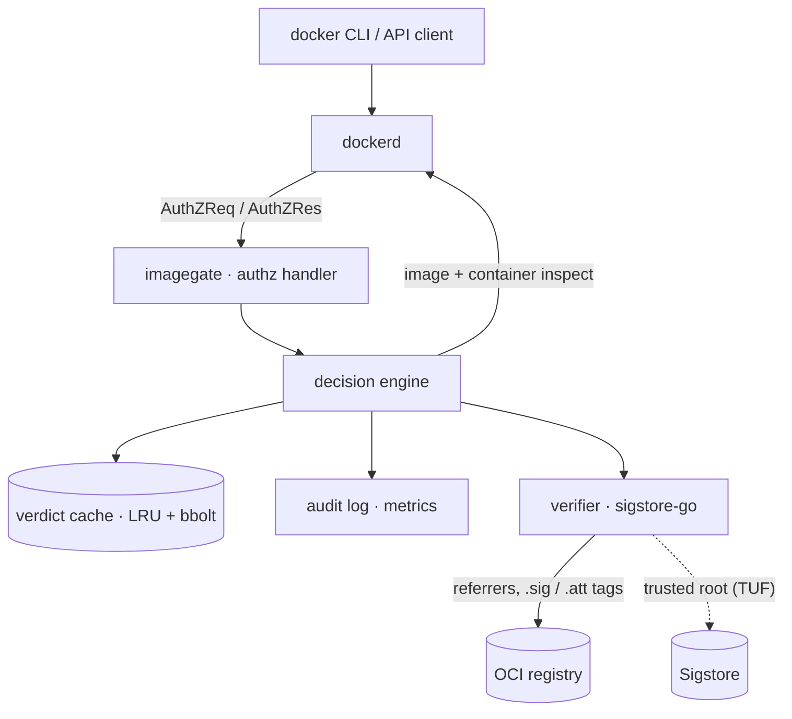
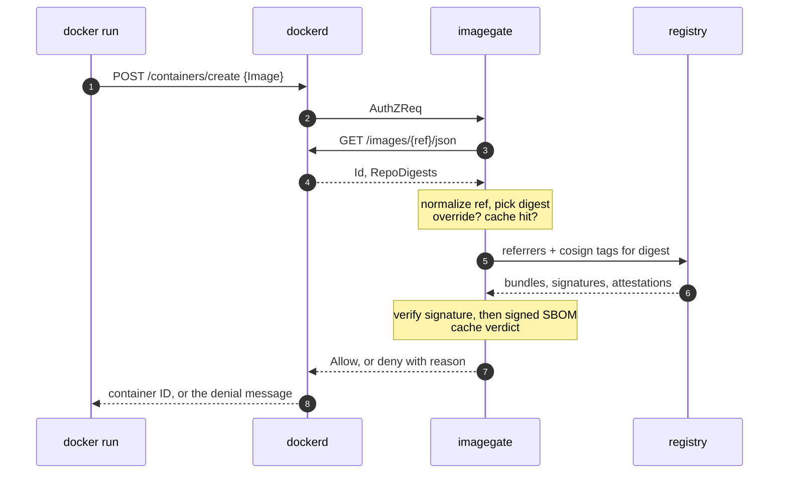
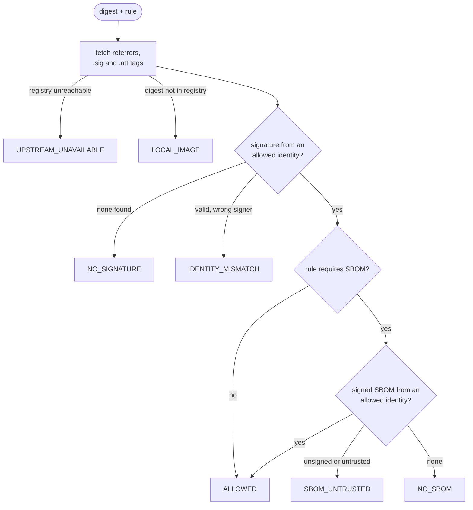

# How it works

imagegate is a standalone Go process. dockerd calls it over
`/run/docker/plugins/imagegate.sock`, using Docker's authorization plugin
protocol, before and after every API request.

## Components

Only the verifier talks to the network. imagegate's own inspect calls to
dockerd come back through the plugin as `GET` requests and are always
allowed.

## What is gated

| Request | What imagegate does |
| --- | --- |
| `POST /containers/create` | Full verification of the image digest |
| `POST /containers/{id}/start`, `/restart` | Re-checks the container's actual image ID; a cache hit after a create |
| Everything else, and every response | Allowed, never verified |

Classification matches dockerd's router: any `/v[0-9.]+` version prefix,
and container names that contain `/`. A POST that looks like a create,
start or restart but does not parse is denied rather than guessed.

## A create, step by step

1. **Parse.** Read `Image` from the request body. A malformed body is denied
   with `BAD_REQUEST`.
2. **Normalize.** `nginx` becomes `docker.io/library/nginx:latest`. Registry
   hostnames are lower-cased, `:443` is dropped (kept on dotless hosts such
   as `registry:443`, which would otherwise read as Docker Hub) and Docker
   Hub aliases fold into `docker.io`.
3. **Resolve the digest.** Ask dockerd for the image. A reference pinned
   with `@sha256:` uses that digest; otherwise the RepoDigests entry for the
   same repository. If dockerd does not have the image yet, the create is
   allowed so `docker run` can pull and retry; the retried create is checked.
4. **Overrides.** A valid break-glass entry for the digest allows it,
   logged at high severity.
5. **Cache.** Key is (repository, digest, policy hash). A hit returns the
   stored verdict.
6. **Rule.** The first rule whose `images` glob matches the repository.
   No match denies with `NO_RULE`.
7. **Signature.** Fetch Sigstore bundles from OCI 1.1 referrers (cosign v3),
   then legacy `sha256-<digest>.sig` tags (cosign v2). Verify with
   sigstore-go against the rule's identities.
8. **SBOM.** The same for in-toto attestations: a DSSE envelope from an
   allowed identity, an allowed `predicateType`, and a subject equal to the
   image digest.
9. **Decide.** Cache the verdict, write the audit record, answer dockerd.

## Verification detail

- **Keyless** identities need a Fulcio certificate chain to the trusted
  root, an embedded SCT (unless `trust.requireSCT: false`), a Rekor
  inclusion proof or signed entry timestamp, and a matching issuer and
  subject.
- **Keyed** identities verify against a listed public key. A transparency
  log entry is checked when present; keyed signatures without one (CI
  without Rekor) verify by key alone.
- Only the digest dockerd resolved counts. On the containerd image store
  that is the index of a multi-platform image, so sign and attest the
  index.

## Caching and performance

- One verification per (repository, digest, policy hash). Allows last 24 h
  and denies 60 s by default; transient failures are never cached.
- Memory LRU (10,000 entries) backed by `/var/lib/imagegate/cache.db`, so a
  restart does not cause a burst of cold verifications.
- Concurrent requests for the same digest share one verification. In the
  tests, 200 parallel creates trigger exactly one.
- The TUF trusted root refreshes in the background, never inline.

| Path | Measured |
| --- | --- |
| imagegate's own work on a cached create | ~15 µs |
| Cached start, end to end through dockerd | 1–2 ms |
| dockerd's image inspect (containerd store, test VM) | ~20 ms |
| Cold verification, local registry | 20–60 ms |

The image inspect dominates a cached create on the containerd store and is
above the spec's 5 ms p99 target there. Measure on your own hosts.
