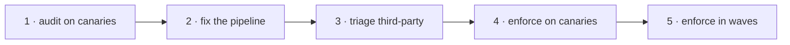

# Rolling out

Roll out in audit mode first, fix what it finds, then enforce in waves.



## 1. Audit on canaries

Deploy with `mode: audit` to about 5% of hosts. Every create is evaluated
and every would-be denial is logged with `"enforced":false`, but nothing is
blocked. Collect two weeks of data:

```sh
journalctl -u imagegate -o cat | jq -r 'select(.decision=="deny") | [.reason, .image] | @tsv' \
  | sort | uniq -c | sort -rn | head -30
```

Or from metrics: `sum by (reason, rule) (rate(imagegate_decisions_total{decision="deny"}[1h]))`.

## 2. Fix the pipeline

Make internal release workflows sign keyless and attest an SBOM
([Signing in CI](signing.md)). Drive `NO_SIGNATURE` and `NO_SBOM` for
internal images to near zero.

## 3. Triage third-party images

For each upstream image seen in audit, choose one:

- the vendor signs it: add their identity or key and a rule;
- mirror it through an internal pipeline that signs and attests the copy;
- replace it.

## 4. Enforce on canaries

Switch the canaries to `mode: enforce` with the [runbook](runbook.md)
published and on-call briefed on [break-glass overrides](runbook.md#break-glass-overrides).

## 5. Enforce in waves

Widen enforcement in waves, gated on the canary deny rate staying under an
agreed threshold. Developer laptops running Docker Desktop are out of scope;
start with shared CI runners and servers.

!!! tip "Alert on these from day one"
    - any `imagegate_decisions_total{reason="OVERRIDE"}`
    - `imagegate_upstream_errors_total` above 5% of decisions for 10 minutes
    - `imagegate_policy_reload_errors_total` increasing
    - `imagegate health` failing
